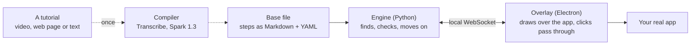
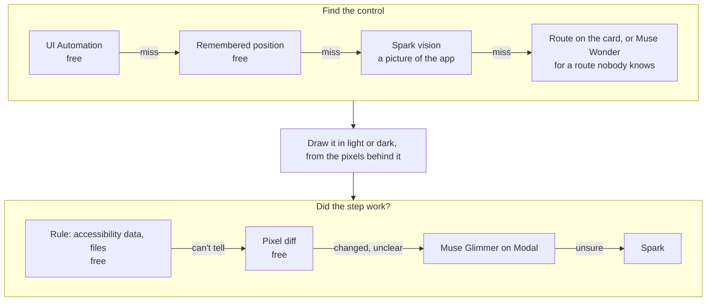

# GhostGuide

**Video tutorials, turned into guidance that runs inside the real app.**

GhostGuide reads an existing tutorial, a YouTube video or a web article, and compiles it into small checkable steps. It then plays those steps over your own copy of the software: it outlines the next button, shows the code to type, notices when you've done the step and moves on. If your version looks different from the author's, it finds the control on your screen, or the new route to it.

It's built on Meta's models for the Meta Global AI Developer Hackathon, in the *Push the Frontier* theme. Most of what it does live is plain code; models step in when that can't tell.

> Windows only. Tested with VS Code 1.14x and SOLIDWORKS 2026 on one PC. See [Limits](#limits-stated-plainly).

## How it works



**Compile once.** A source becomes a base file: what to do, on which control, described by meaning and never by screen position, plus how to tell it's done. Replies are cached, so a tutorial is only paid for once. See [the format](docs/base-format.md).

**Play live.** For each step, the engine tries the cheapest way first and stops at the first sure answer:



Your clicks are never blocked, Next always works, and Skip never pretends a step was checked.

## What the models do

| Model | Where it runs | Job |
|---|---|---|
| **Muse Spark 1.3** | Meta API | Compiles a tutorial in two passes with structured output; explains typed code in plain words; points at controls on a screenshot through our own `point_at`, `draw_line` and `menu_path` tools; last rung of the step check |
| **Muse Wonder** | Meta API | Finds where a control went when an old tutorial's route doesn't exist any more. At most once per step, and its answer is saved unreviewed |
| **Muse Voice Transcribe** | Meta API | A video's narration when captions can't be had |
| **Muse Glimmer** (open weights) | Your own Modal GPU, via [`deploy/modal_glimmer.py`](deploy/modal_glimmer.py) | "Here's the screen, is this step done?" for what a rule can't see, such as geometry appearing. It runs off the PC, because locally it took about 23 s a check on a 12 GB laptop GPU |

No model runs on your PC.

## Measured results

From `tests/accuracy/`, on one PC at 2560×1600 and 150 %, with scripts driving the real overlay and the real apps. These are script runs: treat them as evidence the mechanism works, not as how every person's run will go.

| Check | Result |
|---|---|
| Compiled video against its hand-written reference | **0.74** step match (target 0.85, missed); typed text 0.97 |
| Compiled article against its reference | **0.71** raw (target 0.70, met), 0.73 allowing for what the app changed since 2016 (target 0.80, missed) |
| Compiled video, playing live | 18 of 18 targets found, no check failed |
| Hand-written VS Code tutorial through the real overlay | Every step moved on by itself; hide and resume landed on the right step |
| Hand-written SOLIDWORKS mug, 45 steps, model checks off | Finished on one part, twice in a row. 28 steps moved on by themselves, 17 needed Next. A script drew the canvas geometry |
| Spark on the SOLIDWORKS ribbon, cropped and zoomed | 9 of 9 (5 of 9 on the whole window) |
| Glimmer step checks, measured 31 Oct on Modal | 8 of 9 right, 3.4–5.4 s each; the miss is a handle in hidden-lines view |

## Run it

You need Windows, Python 3.10+ and Node 22.

```bash
py -m pip install pydantic pyyaml httpx websockets pillow uiautomation yt-dlp imageio-ffmpeg numpy pytest
cd overlay && npm install && cd ..
copy .env.example .env
```

The recorded and rule-based parts run with no keys. To compile tutorials or use model looks, put your Meta API key in `.env` and set `MODEL_MODE=live`. `BUDGET_USD` caps what the engine may spend: each call is refused if its worst case would pass it. For Glimmer, the setup steps are at the top of `deploy/modal_glimmer.py`.

**Follow a tutorial:**

```bash
scripts\dev.bat tutorials\mug-solidworks.md --restart
```

SOLIDWORKS maximised, no document open. The VS Code tutorial needs its start state: the folder open with `editor.accessibilitySupport: on` in its workspace settings, so the editor's text can be read.

```bash
scripts\dev.bat tutorials\youtube-clone-vscode.md --restart --window "youtube-clone - Visual Studio Code"
```

**Import your own:**

```bash
scripts\dev.bat import
```

Paste a link or drop a saved page, a video or a text file. A link's words and pictures are read for you. A site that refuses automatic reading is told apart and not retried: open the page in Chrome, scroll to the bottom, save it with Ctrl+S → Webpage, Single File, and drop that file. "Webpage, Complete" can leave pictures out, and the import says so if it did.

**Keys** (all Ctrl+Alt): `→` `←` next and back · `S` skip · `G` show me · `O` the step's source · `H` hide and resume · `D` light or dark · `I` import · `K` the shortcuts · `Q` quit. *Do it for me* has no key on purpose. `scripts\dev.bat nogpu <tutorial>` turns model checks off for one run.

**Check it:**

```bash
py -m pytest -q
```

`tests/accuracy/` holds the Windows checks that drive the real apps. They take the mouse and keyboard.

## Privacy and security

GhostGuide can see an app's window and press keys in it, so its limits are in the code, with tests: [docs/privacy-and-security.md](docs/privacy-and-security.md).

- Only the tutorial's own app window can go to a model, and never while hidden or when *Keep my screen on this PC* is ticked in the tray.
- Keystrokes aren't recorded: the watcher notes that a key was pressed, not which.
- `python -m engine activity` shows everything sent, without its contents. `python -m engine forget` shows what's kept and removes it.
- *Do it for me* is a button, acts only on the front app, and refuses keys that leave it.
- Tutorial files are treated as untrusted text, and web pages can't reach the local connection.

## Limits, stated plainly

- **Windows only,** and tuned on one PC at one scale. A second monitor and other display scales haven't been checked properly. Only a US keyboard is tested, and Ctrl+Alt is AltGr on many layouts.
- **Two apps have rule packs:** VS Code and SOLIDWORKS 2026. Others fall back on names and aliases, then vision, which costs money and is less sure.
- **Compile scores are short of their targets** in the table above. Compiled steps can need fixing by hand, and the base file is meant to be readable for that.
- **The compiled mug hasn't finished in one clean run,** only in pieces. Sight can still put an outline on the wrong small icon.
- **The mug's runs had help a person wouldn't.** A script drew the sketch geometry. In those runs the handle comes out as a separate body, cause not found.
- **Do it for me doesn't draw,** and doesn't run in VS Code or a command line.
- **The Modal endpoint can be woken by anyone who has its URL,** though they get no answer. See the [privacy page](docs/privacy-and-security.md#the-modal-endpoint).
- **Not a sandbox.** A tutorial can still give bad advice. Treat one from a stranger as you would any code from the internet.

## Layout

```
engine/      Python: the compiler (compile/), the live loop (live/), the one door to the models (models/)
overlay/     Electron + TypeScript: draws what the engine says, decides nothing
appmaps/     What's known about each app's controls, from its docs: no positions
tutorials/   Two hand-written reference tutorials, and what the compiler made of their sources
deploy/      Muse Glimmer on Modal
docs/        The base format; privacy and security
tests/       Unit tests; accuracy/ drives the real apps
```

Tutorial sources stay the authors'. Videos and saved pages are never committed: the files link to them.

- Video: [How To Design A YouTube Clone With HTML/CSS](https://www.youtube.com/watch?v=rhPSo4_Tgi0), Web Dev Simplified
- Article: [10 Steps to Creating Your First Product in SOLIDWORKS](https://www.engineersrule.com/10-steps-creating-first-product-solidworks/), Simon Martin, Engineers Rule
