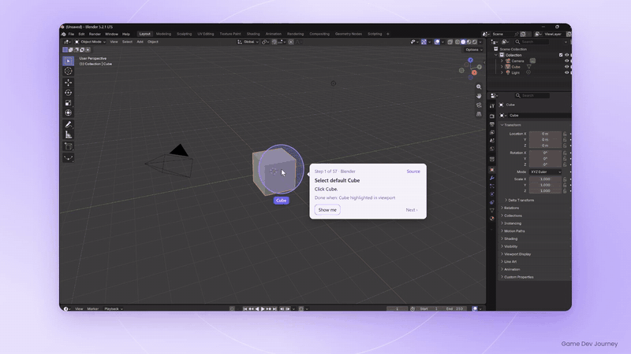
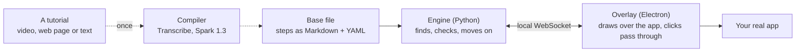
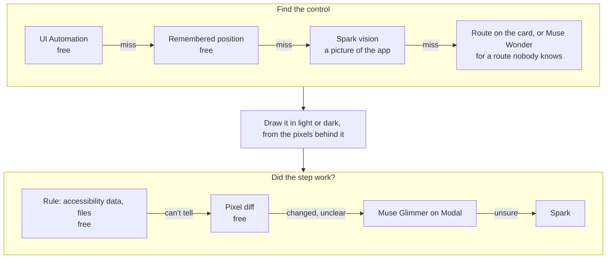

# GhostGuide

**Video tutorials, turned into guidance that runs inside the real app.**

GhostGuide reads an existing tutorial, a YouTube video or a web article, and compiles it into small checkable steps. It then plays those steps over your own copy of the software: it outlines the next button, shows the code to type, notices when you've done the step and moves on. If your version looks different from the author's, it finds the control on your screen, or the new route to it.

It's built on Meta's models for the Meta Global AI Developer Hackathon, in the *Push the Frontier* theme. Most of what it does live is plain code; models step in when that can't tell.

> Windows only. Tested with VS Code 1.14x, SOLIDWORKS 2026 and Blender 5.2 on one PC. See [Limits](#limits-stated-plainly).



*A blog post's Blender tutorial, playing over Blender itself.*

<!-- Demo video: add the link here once it's uploaded -->

## Quick start

You can try it without a key. On Windows, with [Python 3.10+](https://www.python.org/downloads/), [Node 22](https://nodejs.org/) and [Blender](https://www.blender.org/download/) installed:

```bash
git clone https://github.com/kx44/ghostguide.git
cd ghostguide
py -m pip install pydantic pyyaml httpx websockets pillow uiautomation yt-dlp imageio-ffmpeg numpy pytest
cd overlay && npm install && cd ..
copy .env.example .env
scripts\dev.bat tutorials\compiled\blender-barrel.compiled.md --restart
```

Open Blender's default scene first. Steps come up over it one at a time, and Ctrl+Alt+→ moves on. Without a key, each card shows the step and its menu route but can't point at the control, because Blender draws its own buttons, which Windows can't read. With your own Meta key and `FINDER_VISION=on`, it finds them on your screen, as in the GIF. VS Code and SOLIDWORKS controls can be found without a key. [Run it](#run-it) has the details, and [Bring your own keys](#bring-your-own-keys) also lets you compile your own tutorials.

## How it works



**Compile once.** A source becomes a base file: what to do, on which control, described by meaning and never by screen position, plus how to tell it's done. Replies are cached, so a tutorial is only paid for once. See [the format](docs/base-format.md).

**Play live.** For each step, the engine tries the cheapest way first and stops at the first sure answer:



Your clicks are never blocked, Next always works, and Skip never pretends a step was checked.

## What the models do

| Model | Where it runs | Job |
|---|---|---|
| **Muse Spark 1.3** | Meta API | Compiles a tutorial in two passes with structured output; explains typed code in plain words; points at controls on a screenshot through our own `point_at`, `draw_line` and `menu_path` tools; last rung of the step check |
| **Muse Wonder** | Meta API | Finds where a control went when an old tutorial's route doesn't exist any more. At most once per step, and its answer is saved unreviewed |
| **Muse Voice Transcribe** | Meta API | A video's narration when captions can't be had |
| **Muse Glimmer** (open weights) | Your own Modal GPU, via [`deploy/modal_glimmer.py`](deploy/modal_glimmer.py) | "Here's the screen, is this step done?" for what a rule can't see, such as geometry appearing. It runs off the PC, because locally it took about 23 s a check on a 12 GB laptop GPU |

No model runs on your PC.

## Measured results

From `tests/accuracy/`, on one PC at 2560×1600 and 150 %, with scripts driving the real overlay and the real apps. These are script runs: treat them as evidence the mechanism works, not as how every person's run will go.

| Check | Result |
|---|---|
| Compiled video against its hand-written reference | **0.74** step match (target 0.85, missed); typed text 0.97 |
| Compiled article against its reference | **0.71** raw (target 0.70, met), 0.73 allowing for what the app changed since 2016 (target 0.80, missed) |
| Compiled video, playing live | 18 of 18 targets found, no check failed |
| Hand-written VS Code tutorial through the real overlay | 29 of 29 checks. Every step moved on by itself; hide and resume landed on the right step |
| Compiled Blender barrel from a blog post, 57 steps | 57 of 57 on one part, 25 moved on by themselves, 32 needed Next. A script clicked 7 outliner rows and 2 fields at measured positions, followed one route by hand and placed the loop cuts, and the compiled file was corrected by hand first |
| Hand-written SOLIDWORKS mug, 45 steps, model checks off | Finished on one part, twice in a row. 28 steps moved on by themselves, 17 needed Next. A script drew the canvas geometry |
| Spark on the SOLIDWORKS ribbon, cropped and zoomed | 9 of 9 (5 of 9 on the whole window) |
| Glimmer step checks on Modal | 9 of 9 right, 3.2–4.3 s each, 20.7 s on the first call while the GPU wakes |
| Overlay's own controls, through the real window | 52 of 52 scripted, 1 left for the eye (tray focus). Run it alone: other programs taking focus fail it |
| Unit tests | 600 passed |

## Run it

### What to install

| You need | Get it from | What for |
|---|---|---|
| Windows | | GhostGuide reads and draws over Windows apps. It doesn't run on macOS or Linux |
| Python 3.10+ | [python.org](https://www.python.org/downloads/) | The engine. The `py` command comes with it |
| Node 22 | [nodejs.org](https://nodejs.org/) | The overlay. `npm install` fetches Electron |
| Git | [git-scm.com](https://git-scm.com/downloads) | To clone this repo |
| The tutorial's app | Its maker | For example VS Code, SOLIDWORKS or Blender. GhostGuide runs over your own copy |

```bash
git clone https://github.com/kx44/ghostguide.git
cd ghostguide
py -m pip install pydantic pyyaml httpx websockets pillow uiautomation yt-dlp imageio-ffmpeg numpy pytest
cd overlay && npm install && cd ..
copy .env.example .env
```

### Bring your own keys

**This repo comes with no API key and no shared service. Everything you turn on runs on your own accounts, and you pay for what you use.** Keys go in your `.env`, which git ignores. Never commit it or share it.

| What you want | What you need | In `.env` | Cost to you |
|---|---|---|---|
| Play the tutorials in this repo, with rules and pixel checks | Nothing | Leave as copied | Free |
| Compile your own tutorials; find controls by sight | A Meta API key from [dev.meta.ai](https://dev.meta.ai) | `META_API_KEY=your key`, `MODEL_MODE=live`, `FINDER_VISION=on` | Meta's prices. A first compile was about $0.25 for an article and $0.62 for a 9-minute video |
| Muse Glimmer step checks | A [Modal](https://modal.com) account, with the steps at the top of [`deploy/modal_glimmer.py`](deploy/modal_glimmer.py) (`py -m pip install modal`, then `py -m modal setup`) | `CHECK_MODELS=on`, `GLIMMER_MODAL_URL=your endpoint`, `GLIMMER_MODAL_TOKEN=your token` | Modal's GPU prices, about $2.24 an hour while it's up. It stops after five idle minutes |

`BUDGET_USD` caps what the engine may spend with Meta, $4 by default: each call is refused if its worst case would pass it. It doesn't cap Modal, so check that on Modal's dashboard. `MODEL_MODE=replay`, the default, never calls a paid API. Without a key, compiling and finding by sight aren't available, and a step only rules can't check needs Next.

### Use it

**Follow a tutorial:**

```bash
scripts\dev.bat tutorials\mug-solidworks.md --restart
```

SOLIDWORKS maximised, no document open. The VS Code tutorial needs its start state: the folder open with `editor.accessibilitySupport: on` in its workspace settings, so the editor's text can be read.

```bash
scripts\dev.bat tutorials\youtube-clone-vscode.md --restart --window "youtube-clone - Visual Studio Code"
```

The compiled tutorials in `tutorials/compiled/` play the same way, for example Blender's barrel, starting from Blender's default scene:

```bash
scripts\dev.bat tutorials\compiled\blender-barrel.compiled.md --restart
```

**Import your own:**

```bash
scripts\dev.bat import
```

Paste a link or drop a saved page, a video or a text file. A link's words and pictures are read for you. A site that refuses automatic reading is told apart and not retried: open the page in Chrome, scroll to the bottom, save it with Ctrl+S → Webpage, Single File, and drop that file. "Webpage, Complete" can leave pictures out, and the import says so if it did.

**Keys** (all Ctrl+Alt): `→` `←` next and back · `S` skip · `G` show me · `O` the step's source · `H` hide and resume · `D` light or dark · `I` import · `K` the shortcuts · `Q` quit. *Do it for me* has no key on purpose. `scripts\dev.bat nogpu <tutorial>` turns model checks off for one run.

**Check it:**

```bash
py -m pytest -q
```

`tests/accuracy/` holds the Windows checks that drive the real apps. They take the mouse and keyboard.

## Troubleshooting

| What you see | What to do |
|---|---|
| Nothing is drawn over the app | Look at the engine's window. It should say `engine listening on ws://127.0.0.1:8765`, then `overlay connected`. If it closed or shows an error, another engine may still be running: close every GhostGuide window and start again |
| "Can't find *the app*. Open it and click on it…" | Click inside the app, or press **Use this window** on the card. GhostGuide remembers your choice |
| "Not found (…). You can still do it by hand; Next moves on." | Do the step yourself, then press Ctrl+Alt+→. Finding by sight needs a Meta key and `FINDER_VISION=on` |
| The outline sits beside the control | Display scaling other than 150 % and second monitors aren't well tested. Try the app on the main monitor, maximised |
| VS Code steps never move on by themselves | Turn on `"editor.accessibilitySupport": "on"` in the folder's `.vscode/settings.json`, so the editor's text can be read |
| A web page won't import | The site refuses automatic reading. Scroll to the bottom of the page, save it with Ctrl+S → Webpage, Single File, and drop the file in |
| `META_API_KEY is not set` | Put your key in `.env`, or set `MODEL_MODE=replay` to make no paid calls |
| "This would pass the spending cap (BUDGET_USD)…" | Your own cap stopped it. Raise `BUDGET_USD` in `.env` only if you mean to spend more. `py -m engine spend` shows the total |
| The first Glimmer check takes about 20 s | The GPU is waking up. Later checks take 3 to 5 s |
| Ctrl+Alt shortcuts do nothing | On many non-US keyboards Ctrl+Alt is AltGr. Only a US layout is tested, so switch to one while you use GhostGuide |
| Want to start a tutorial over | Add `--restart` to the command |

`cache/logs/engine.log` shows how each step's finding and checking went in the last run. `py -m engine activity` lists everything that left your PC.

## Privacy and security

GhostGuide can see an app's window and press keys in it, so its limits are in the code, with tests: [docs/privacy-and-security.md](docs/privacy-and-security.md).

- Only the tutorial's own app window can go to a model, and never while hidden or when *Keep my screen on this PC* is ticked in the tray.
- Keystrokes aren't recorded: the watcher notes that a key was pressed, not which.
- `python -m engine activity` shows everything sent, without its contents. `python -m engine forget` shows what's kept and removes it.
- *Do it for me* is a button, acts only on the front app, and refuses keys that leave it.
- Tutorial files are treated as untrusted text, and web pages can't reach the local connection.

## Limits, stated plainly

- **Windows only,** and tuned on one PC at one scale. A second monitor and other display scales haven't been checked properly. Only a US keyboard is tested, and Ctrl+Alt is AltGr on many layouts.
- **Two apps have rule packs:** VS Code and SOLIDWORKS 2026. Blender has a built-in map but no rules. Others fall back on names and aliases, then vision, which costs money and is less sure. A tutorial can name a different app per step and move between them.
- **Compile scores are short of their targets** in the table above. Compiled steps can need fixing by hand, and the base file is meant to be readable for that.
- **The compiled mug hasn't finished in one clean run,** only in pieces. Sight can still put an outline on the wrong small icon.
- **The mug's runs had help a person wouldn't.** A script drew the sketch geometry. In those runs the handle comes out as a separate body, cause not found.
- **The hand-written mug hasn't finished with model checks on.** The best run stopped at step 18 of 45.
- **Blender's run had help too,** listed in the results above, so a person following it would meet more "Not found" cards. Finding Add › Mesh › Cylinder is unreliable, many steps never check done, and a card with nothing to point at can cover the operator panel.
- **Do it for me's Ctrl+A can hit a Blender hotkey if its click misses a field.** Don't use it on field steps there.
- **Roblox Studio hasn't been walked end to end,** only five chosen steps of its 67.
- **Do it for me doesn't draw,** and doesn't run in VS Code or a command line.
- **The Modal endpoint can be woken by anyone who has its URL,** though they get no answer. See the [privacy page](docs/privacy-and-security.md#the-modal-endpoint).
- **Not a sandbox.** A tutorial can still give bad advice. Treat one from a stranger as you would any code from the internet.

## Layout

```
engine/      Python: the compiler (compile/), the live loop (live/), the one door to the models (models/)
overlay/     Electron + TypeScript: draws what the engine says, decides nothing
appmaps/     What's known about each app's controls, from its docs: no positions
tutorials/   Two hand-written reference tutorials; compiled/ holds what the compiler made of real sources
deploy/      Muse Glimmer on Modal
docs/        The base format; privacy and security; the demo GIF
tests/       Unit tests; accuracy/ drives the real apps
```

## Contributing

Issues and pull requests are welcome. Before a pull request, run the checks:

```bash
py -m pytest -q
cd overlay && npm run typecheck && npm run unit
```

- **A new tutorial:** write it in the [base format](docs/base-format.md), or compile one with `py -m engine compile`, then check it with `py -m engine validate "tutorials/*.md"`. Link to the source and credit its author. Don't commit the video or saved page.
- **A new app:** add `appmaps/<app>-<version>.yaml` with facts from the app's own docs, such as names, aliases and menu routes. Never add screen positions: positions GhostGuide learns stay on your PC, in `%APPDATA%/GhostGuide/appmaps/`.
- **Never commit** `.env`, `cache/` or screenshots of your screen.

## Credits

The tutorials belong to their authors. GhostGuide links to them, and never commits their videos or saved pages.

- Video: [How To Design A YouTube Clone With HTML/CSS](https://www.youtube.com/watch?v=rhPSo4_Tgi0), Web Dev Simplified
- Article: [10 Steps to Creating Your First Product in SOLIDWORKS](https://www.engineersrule.com/10-steps-creating-first-product-solidworks/), Simon Martin, Engineers Rule
- Blog post: [Blender Barrel](https://sites.google.com/view/game-dev-guide/home/blender/blender-barrel), Game Dev Journey
- Video: [ABSOLUTE Beginner Basics.. Roblox Studio For Noobs 2025](https://www.youtube.com/watch?v=-5OOovmkJss), RoBuilder
- Docs: [Virtual Environments and Packages](https://docs.python.org/3/tutorial/venv.html), the Python tutorial

## License

The code is under the [MIT License](LICENSE). The tutorials' own content still belongs to their authors, linked above, and the licence doesn't cover it.
