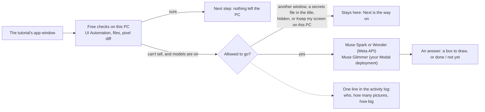

# Privacy and security

GhostGuide can see an app's window and can press keys in it, so what it does with that needs to be plain. This page says what the code does today. Every line under "What it does" has a test in [`tests/test_governance.py`](../tests/test_governance.py), unless it says otherwise.

## In one minute

- **Models are off until you turn them on.** With `CHECK_MODELS=off` and `FINDER_VISION=off`, the defaults in `.env.example`, no picture of your screen leaves your PC during a tutorial.
- **Only the tutorial's app is ever sent,** and only when a free check couldn't tell or a control couldn't be found by name. With finding on, that includes looking for the next few steps' controls before they come up, even with the app behind other windows. `FINDER_AHEAD=off` stops that part.
- **You can stop it at any moment:** *Keep my screen on this PC* in the tray, or `GG_LOCAL_ONLY=on`. Hide also stops models looking. The tray says what's happening right now.
- **Your keys aren't recorded.** The watcher notes that a key was pressed, not which.
- **`python -m engine activity` shows what left.** `python -m engine forget` shows what's kept and removes it.

## What it touches

### Your screen

| | |
|---|---|
| **What it looks at** | The app's own window and that app's dialogs and menus, using `PrintWindow`. Other windows on top aren't in the picture, and neither is the overlay. |
| **Also** | A small ring of pixels around the target, measured to pick light or dark colours. It's thrown away at once and never sent. |
| **Saved to disk?** | The live loop writes no screenshots. The check scripts under `tests/` do, into `cache/`, when you run them. |
| **When it can go to a model** | Only if models are on and only with an app the tutorial works in in the picture: to find a control UI Automation can't see, to check a box found by sight, or to check a step that a rule and a pixel diff couldn't settle. While you follow a tutorial in one app, the next few steps' controls are looked for ahead of time, at most 60 looks a run, and this doesn't need the app in front. A step can name another program to work in (`app`); in such a tutorial, a window goes only while it's the one in front. A window a step only watches is never sent. So a tutorial file does choose which programs can be looked at while you're in them: the card always says which program a step is in. |
| **What stops it** | Hide. *Keep my screen on this PC*. A window title that names a secrets file (`.env`, `id_rsa`, `*.pem`, `*.key`, `*.kdbx`, or the words secrets, credentials, password, private key). In each case the step falls back to free checks and the Next button. |

The title rule is a guard for the common case. It reads the title only, so a secret that's visible in a file with an ordinary name isn't caught. If you have one on screen, use the tray switch.

### Your mouse and keyboard

GhostGuide watches input with Windows Raw Input, a copy of events that sits outside the input chain, so it can't slow down or swallow anything you do.

- It keeps the kind of event (click, key, wheel, move), the position and the time, in memory, the last 400 events at most.
- The key code is dropped where it arrives. Nothing reads it and nothing writes these events to disk.
- Typed text is checked by reading the app's accessibility data or the saved file, not from this watcher.
- It keeps nothing while no overlay is connected.

### What leaves your PC, and where to

| Goes to | What | When |
|---|---|---|
| **Meta API**: Muse Spark 1.3 | A picture of the app, and the step's title, label and description | `FINDER_VISION=on`: a control can't be found by name. `CHECK_MODELS=on`: last rung of a step check |
| **Meta API**: Muse Wonder | A picture of the app and the same text | `FINDER_VISION=on`: nothing else found the control. At most once per step |
| **Your Modal deployment**: Muse Glimmer | A JPEG of the app and the step's check sentence, over https with a token | `CHECK_MODELS=on`: a rule and a pixel diff couldn't tell |
| **Meta API**: Spark, Voice Transcribe | The tutorial you're importing: its text, frames and narration | When you import a tutorial, not while you follow one |
| **YouTube or Vimeo, or a web page** | An ordinary download of the link you gave, or of the page a tutorial names, under GhostGuide's own name | When you import, or open a step's source. A site that refuses is told apart and not retried |

**Spark Contributor.** Meta's cheaper Contributor rate comes with Meta being allowed to train on what's sent. Pictures of your screen never go there unless you set `SCREENS_MAY_TRAIN=on`. `engine compile --tune` uses it for tutorials, which you ask for by name. Read Meta's and Modal's own terms for how they treat what they receive; this page can only say what GhostGuide sends.

**The activity log.** `cache/logs/activity.jsonl` gets one line per send: when, to which host, which model, how many pictures, how many bytes. It never holds a picture, a prompt or a typed value. `python -m engine activity` prints it. The tray's menu shows the count for this run.

### Do it for me

It sends real clicks and keys, so it has the tightest limits.

- **It's a button.** It has no hotkey and never runs by itself. It's only offered for buttons, menus, fields and shortcuts, and never for drawing on the canvas.
- **A box only sight has found takes a second press,** so you can look at the outline first; the button says so. A box the app's tooltip, a model's second look or a remembered look has confirmed runs on the first press. Any key that deletes always takes a second press.
- **It only acts on the app.** The app must be the front window and own the spot it would click. That's re-checked before each input and before each typed character, so if you switch windows mid-text, typing stops.
- **It won't do everything a tutorial file asks.** It refuses to press keys that leave the app (Alt+Tab, Alt+Esc, Ctrl+Esc, Ctrl+Shift+Esc, Alt+Space, Ctrl+Alt+Del). It refuses to type a value with control characters, including line breaks, or longer than 200 characters; those stay on the card to copy. The only keys allowed after typing are Enter and Tab.
- **It's on the record.** Each act goes in the activity log as the step and the kinds of input, not the text.

It's only wired up for apps without a full accessibility rule pack: SolidWorks today, not VS Code.

### Tutorial files and pages are someone else's text

A tutorial, whether you compiled it or were sent it, is treated as untrusted.

- **Every file is checked before it plays,** not just when compiled: a strict schema, safe YAML, no screen positions, no file checks outside the tutorial's working folder, and a source link that must be a web link.
- **Text is shown as text.** The overlay escapes every value it draws, and the source window uses `textContent`, never HTML. All three pages have a content policy that blocks outside scripts.
- **Windows are locked down.** Each one is sandboxed with context isolation and no Node in the page. None can navigate or open another window. Every permission request (camera, microphone, screen) is denied.
- **Only web links reach your browser,** checked in both the engine and the overlay's main process.
- **A saved page's missing pictures can load from the site.** When a saved page didn't keep a picture, the source window shows it from the address the page gives, over https, with no referrer. So that site sees your IP address, as it would in a browser. Nothing else in that window loads from the web, and these pictures never go to a model.
- **A saved page's pictures must sit beside it.** A page can't point at another file on your disk to get it sent to a model.
- **This PC and its network aren't fetched.** A link to `localhost`, a private address or a `.local` name is refused, on each redirect as well. Pages stop at 8 MB and pictures at 20 MB.
- **A model's answer can't run anything.** Live, its only tools are `point_at`, `draw_line`, `menu_path` and `not_found`, which become something to draw. Compiled, its answer has to pass the same checks as any tutorial file. A route from Muse Wonder goes to your local map marked unreviewed.

A hostile tutorial can still give bad instructions: a misleading step, or code on a card that you might copy and run. GhostGuide can limit what it does for you. It can't tell you whether a stranger's advice is good, so treat a tutorial as you would any other code from the internet.

### The local connection

The engine and overlay talk over a WebSocket on `127.0.0.1`. It refuses any connection that carries a browser `Origin` header, because browsers let any web page open a WebSocket to your own PC, and such a page could otherwise press Do it for me or start a paid compile.

It doesn't authenticate other programs running under your account. Those can already read your files and send input, so a token wouldn't change much.

### API keys

- Keys live in `.env`, which git ignores. `.env.example` holds no values.
- The Meta key and the Glimmer token only travel over https; plain http is allowed only to this PC itself.
- Keys don't appear in the cost log, the activity log, recorded answers or error messages, and a test checks that no value from your `.env` is in a tracked file.
- Every paid call is checked against `BUDGET_USD` first, using its worst-case cost, and refused if it would pass the cap.

### What's kept on your PC

| Where | What |
|---|---|
| `cache/sessions/` | Which step you reached in each tutorial |
| `cache/sources/` | Tutorial clips and readings, for the source view |
| `cache/compiled/` | What compiling read: the tutorial's frames and text |
| `cache/cassettes/` | Recorded model answers, in `record` mode. Pictures are replaced by a hash |
| `cache/logs/` | Spend, activity, scores, and `engine.log`: what the finder and checks said on the last run, not what's on screen |
| `%APPDATA%\GhostGuide\appmaps\` | Where this app's buttons are, relative to its window, with a 16×16 grey thumbnail of each to tell neighbours apart |
| `%APPDATA%\GhostGuide\overlay-settings.json` | Whether the shortcuts panel is open |

`python -m engine forget` lists these and `--yes` removes them, apart from the settings file. Two things stay: the spend log, because the budget cap adds it up, and your tutorial files. It removes links without following them.

### The Modal endpoint

`deploy/modal_glimmer.py` is a small service you deploy on your own Modal account. It checks a bearer token in constant time, refuses every request if the secret is missing, takes only JPEG or PNG up to a size limit, and doesn't store what it receives. Its volume holds only the model weights. The container scales to zero after five idle minutes.

**A known limit:** the token is checked inside the container, so a request without one, sent by someone who has the URL, can wake the GPU for a few minutes even though it gets no answer. The URL is kept in `.env` for that reason. Modal's proxy auth would close this and isn't set up.

## What this doesn't protect against

- **Malware running as you.** It can read `.env` and everything else in your account.
- **Someone sitting at your PC,** or a second user account on it connecting to the local port.
- **What a provider does after receiving a request,** beyond the terms it offers.
- **A secret visible in the app's window under an ordinary file name,** if models are on.
- **A public address that later resolves to a private one** (DNS rebinding): the check happens just before each request, not during it.

## Reporting a problem

Please open an issue on the repository. If it's a vulnerability, describe the impact and leave out a working exploit until there's a fix.
